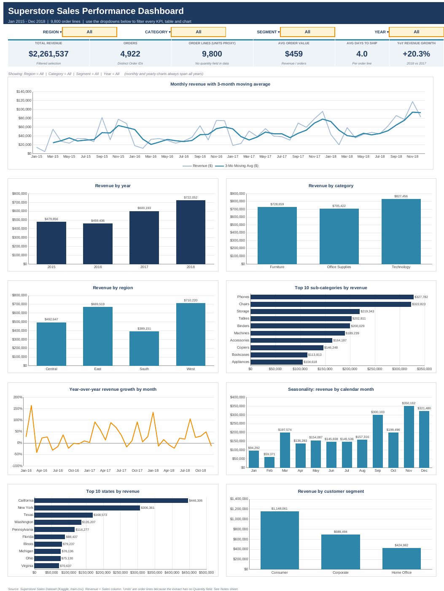

# Sales Performance Dashboard in Excel (Superstore)

An interactive Excel dashboard that answers the questions a sales manager asks first: **how much did we sell, is it growing, where, and when?** It is built from the Kaggle *Superstore Sales* dataset (9,800 order lines, Jan 2015 - Dec 2018) and includes cleaning, pivot-style summaries, charts, filters and MoM/YoY analysis.



## Headline results

| Metric | Value |
|---|---|
| Total revenue | **$2,261,537** |
| Orders / order lines | 4,922 / 9,800 |
| Average order value | $459 |
| Revenue 2015 / 2016 / 2017 / 2018 | $479.9K / $459.4K (-4.3%) / $600.2K (+30.6%) / $722.1K (+20.3%) |
| Revenue CAGR 2015-2018 | 14.6% |
| Top category | Technology (36.6%) |
| Top sub-categories | Phones ($327.8K), Chairs ($322.8K), Storage ($219.3K) |
| Top region / state | West (31.4%) / California (19.7%) |
| Seasonality | Nov + Dec = 30% of revenue; Sep-Dec = 52% |

Full written findings are on the workbook's **Insights** sheet.

## What is in the workbook (`dashboard/Superstore_Sales_Dashboard.xlsx`)

| Sheet | Purpose |
|---|---|
| **Dashboard** | 6 KPI tiles, 4 filter dropdowns (Region, Category, Segment, Year) and 9 charts. Everything recalculates when a filter changes. |
| **Analysis** | Pivot-style tables: monthly trend with **MoM %, YoY %** and 3-month moving average; yearly summary; revenue by category, region, segment; ranked sub-categories and states; seasonality. |
| **Insights** | Written business findings and a recommendation. |
| **Data** | Cleaned source data as an Excel Table (`tblSales`) plus formula helper columns (Year, Month, Ship Days, order flags). |
| **Notes** | Data-cleaning log, metric definitions, how-to. |

## Data cleaning (documented on the Notes sheet)

* `Order Date` / `Ship Date` were text in dd/mm/yyyy: converted to real dates (day-first parsing).
* 11 blank Postal Codes (all Burlington, Vermont): filled with 05401. Not used in any metric.
* No trailing spaces and no Ship-before-Order date errors were found.
* **One pair of lines is identical except Row ID** (order US-2015-150119, $281.37 each, 0.01% of revenue). It is kept and flagged, because without a Quantity column it may be two units of one item.
* `Country` is constant (United States) and kept.

## Important limitations (please read)

1. **No Quantity, Profit or Discount columns** exist in this Kaggle extract. "Units sold" is therefore approximated by **order lines**, and the analysis covers **revenue only**, not profitability.
2. **Pivot tables and slicers:** the summary tables are built with live `SUMIFS` formulas over named ranges (pivot-*style*), and the filters are dropdown cells that act like slicers. They are not native Excel PivotTable/Slicer objects, because those cannot be authored reliably outside Excel. Native versions take about two minutes (below).

### Add native PivotTables and Slicers in Excel
1. Open the **Data** sheet, click any cell in the table, then **Insert > PivotTable** (source `tblSales`) onto a new sheet.
2. Drag **Month** to Rows (right-click > Group > Months and Years), **Sales** to Values (Sum), and **Order ID** to Values (Distinct Count: tick *Add this data to the Data Model*).
3. For MoM / YoY: add Sales again, right-click it > **Show Values As > % Difference From** (Base field *Month*, item *previous*) or *% Of Parent Total* as needed.
4. **PivotTable Analyze > Insert Slicer** and tick **Region** and **Category**; use *Report Connections* to link several pivots.
5. **Insert > PivotChart** for each pivot.

## How the formulas work

* Named ranges (`d_Sales`, `d_Region`, `d_Category`, ...) point at the Data columns.
* Dashboard dropdowns feed criteria cells on **Analysis** (`All` becomes the wildcard `*`).
* Every table is `SUMIFS` / `COUNTIFS` over those names, so no volatile or dynamic-array functions are used and the file works in Excel 2010+ and LibreOffice.
* Distinct orders use first-line flags (`New Order`, `New Order (Cat)`) summed with `SUMIFS`.
* Rankings use `LARGE` + `INDEX/MATCH`.

## Verification

All 59,502 formulas recalculate with zero errors. KPIs were tied out to an independent pandas calculation, both unfiltered and under a combined filter (West / Technology / Consumer / 2018): revenue, distinct orders, order lines, average order value, average ship days and YoY growth match exactly.

## Repository layout

```
.
├── dashboard/Superstore_Sales_Dashboard.xlsx   # the deliverable
├── data/superstore_train_raw.csv               # original Kaggle file
├── data/superstore_cleaned.csv                 # cleaned export
├── scripts/build_dashboard.py                  # rebuilds the workbook from the raw CSV
├── docs/dashboard_preview.png
├── requirements.txt
└── README.md
```

Rebuild: `pip install -r requirements.txt && python scripts/build_dashboard.py` Excel calculates all formulas when the file is opened. To pre-cache values for viewers that do not calculate (previews, pandas), round-trip it once through LibreOffice: `soffice --headless --convert-to xlsx --outdir out dashboard/Superstore_Sales_Dashboard.xlsx`.

## Tools
Excel (formulas, named ranges, tables, data validation, charts); Python (pandas, openpyxl) used only to build and verify the workbook.
